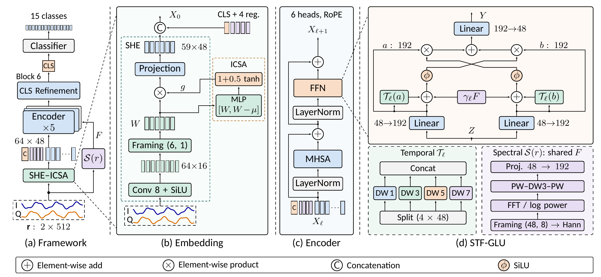
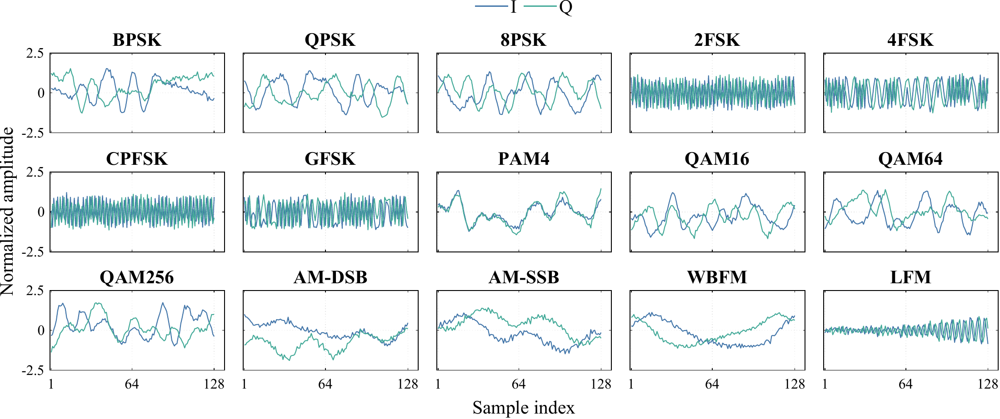
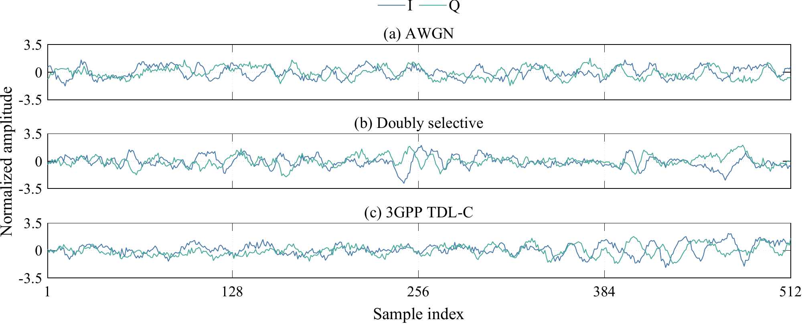
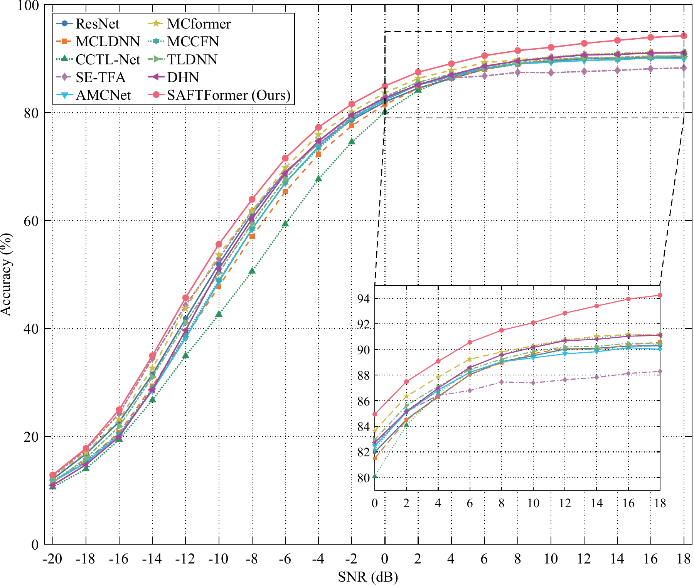

# SAFTFormer: Automatic Modulation Recognition over Fading Channels

SAFTFormer is a compact Transformer for classifying modulation directly from
received in-phase and quadrature (I/Q) samples. This EE6008 group project
includes the signal generator, the model, nine reproduced baselines, and a
shared training and evaluation framework.

On the project's held-out **simulated** test set, the selected Full model
achieves **69.81% overall accuracy** across all SNRs and **94.24% at 18 dB**.
These are results from the saved single-seed experiments; they do not establish
performance on real over-the-air data or unseen channel types.

## Approach



The diagram shows the classification-relevant information flow. The original
Full implementation executes the patch FFN in block 6 as well; its final patch
updates cannot reach the CLS classifier because no token-mixing layer follows.
The parameter and MAC counts below include the executed Full implementation.

1. **Input and embedding.** Each example is a `2 x 512` I/Q window. The
   Symbol-Scale Hierarchical Embedding (**SHE**) converts groups of eight
   samples into 64 short signal units. Six adjacent units form an overlapping
   48-sample frame with an 8-sample hop, giving 59 frame tokens.
2. **Input-conditioned aggregation.** Input-Conditioned Symbol Aggregation
   (**ICSA**) scores each unit using its features and its deviation from the
   frame mean. A bounded scalar gate weights the unit before the frame
   projection. This is a learned feature gate, not an explicit channel estimator
   or a claim of symbol synchronization.
3. **Transformer encoder.** One CLS token and four learned register tokens are
   added to the frame tokens. Six attention blocks of width 48 use six heads and
   temporal rotary position encoding; the CLS output feeds the classifier.
4. **Temporal-spectral FFN.** The Symmetric Time-Frequency Gated Linear Unit
   (**STF-GLU**) extends symmetric dual-branch SiLU gating. Four depthwise
   temporal kernels of sizes 1, 3, 5 and 7 capture different token scales. A
   shared spectral conditioner extracts Hann-windowed complex-FFT log-power
   features from the same I/Q windows and supplies a learned per-block condition.
   Conditions act on frame tokens; CLS and register tokens use the unconditioned
   dual-branch gate.

For branch features `a` and `b`, temporal operator `T`, shared spectral
feature `F` and learned block scale `gamma`, the conditioned gate is:

```text
u = a + T(a) + gamma * F
v = b + T(b) + gamma * F
output = projection(a * SiLU(v) + b * SiLU(u))
```

The backbone is a one-dimensional, supervised adaptation inspired by
[DINOv3](https://arxiv.org/abs/2508.10104); the model is trained from scratch,
without DINOv3 pretrained weights or its self-supervised training recipe. The
frame-wise and symmetric dual-branch ideas are informed by
[FEA-T](https://doi.org/10.1109/LCOMM.2022.3213523). The project modifications
and baseline implementations should be understood in that context.

### Full model configuration

The published [configuration](src/configs/ours_saftformer/full.json) describes
the complete SAFTFormer design:

| Component | Configuration and information flow |
| --- | --- |
| Input | Two I/Q channels, 512 samples, 15 output classes |
| SHE | An 8-sample, stride-8 convolution maps I/Q to 16 features per signal unit; six units form each frame |
| ICSA | An 8-unit hidden scorer uses content and deviation from the frame mean; gates lie between 0.5 and 1.5 |
| Frame projection | 48 samples per frame, stride 8, producing 59 tokens of width 48 |
| Encoder | Six blocks, six attention heads, one CLS token and four register tokens; 64 tokens in total |
| Position encoding | Temporal RoPE, base 100, with coordinate rescaling up to a factor of 2 during training |
| STF-GLU | Two `48 -> 192` branches, symmetric SiLU gating, followed by a `192 -> 48` projection |
| Temporal condition | Each 192-channel branch splits into four 48-channel groups, using depthwise kernels `[1, 3, 5, 7]` |
| Spectral condition | Aligned 48-sample Hann windows, complex FFT, normalized log power, an 8-channel PW-DW-PW network with kernel 3, then a `48 -> 192` projection |
| Residual blocks | Pre-LayerNorm (`eps=1e-5`), LayerScale initialized to `1e-5`, uniform DropPath probability 0.1; ordinary and attention dropout are 0 |
| Classifier | Final LayerNorm and the 48-dimensional CLS feature mapped to 15 logits |

The spectral features are computed once per input and shared across the six
blocks, each with its own learned scalar. The temporal kernels and spectral
scalars start at zero; ICSA starts with unit gates. The model therefore learns
the strength of these conditions during training.

Training uses AdamW with learning rate `1e-3`, weight decay `1e-4`, batch size
512 and up to 100 epochs. Validation-loss plateau scheduling uses patience 5
and a reduction factor of 0.5, with a learning-rate floor of `1e-5`.
Early stopping uses patience 15; warmup is disabled. Gradient clipping is 5,
AMP is enabled on CUDA, and the seed is 42. The reported checkpoint is
`best.pt`, selected by validation loss. See the
[configuration guide](src/configs/ours_saftformer/README.md) for tensor shapes
and configuration field details.

## Dataset

The MATLAB-generated dataset contains **3.3 million** examples: 15 modulation
classes, 11 channel conditions and 20 SNR levels from -20 to 18 dB in 2 dB
steps. The saved split is stratified within each modulation/channel/SNR cell:
60% training, 20% validation and 20% testing (660,000 test examples).

| Coverage | Included settings |
| --- | --- |
| Modulations | BPSK, QPSK, 8PSK, 2FSK, 4FSK, CPFSK, GFSK, PAM4, QAM16, QAM64, QAM256, AM-DSB, AM-SSB, WBFM, LFM |
| Channels | AWGN, Rayleigh, Rician, Nakagami, doubly selective, frequency-selective Rayleigh, frequency-selective Rician, lognormal shadowing, 3GPP TDL-A, TDL-C, TDL-E |
| SNR | -20 to 18 dB, step 2 dB |
| Examples per modulation/channel/SNR cell | 1,000 |
| Stored signal | 512 complex samples, represented by two I/Q channels |

Signals follow the generation pipeline used in the presentation:

```text
Modulation synthesis -> Channel -> RMS normalization -> I/Q export
```

The channel stage includes propagation effects, frequency/phase offsets and
additive noise. The following figures show stored test examples from this
dataset, using the same plots as the slides.

### Modulation waveform overview



AWGN at 18 dB SNR. Each panel shows the first 128 of 512 complex samples from
an independent test example. Blue denotes I and teal denotes Q; all panels
share an amplitude scale. The examples are the first stored test record in
each modulation/channel/SNR cell, displayed without additional filtering.

### Channel waveform examples



QPSK at 10 dB SNR under AWGN, doubly selective and 3GPP TDL-C conditions.
Each panel shows all 512 samples with a shared amplitude scale. These are
independent test bursts selected from the respective channel cells, rather
than paired channel transformations of the same transmitted waveform.

### Obtain the dataset

The dataset and trained checkpoints are **not included in this repository**.
Download the dataset using the [dataset instructions](datasets/README.md), or
generate it with [MATLAB](src/dataset_generator_matlab/README.md), and place it
at `datasets/matlab_amr_dataset.mat`. To evaluate the reported checkpoint,
obtain it separately and place it at `src/runs/saftformer_full/best.pt`;
otherwise train a new model as shown below. The link to the dataset does not
imply that checkpoints are available there.

## Results



The table summarizes existing held-out test evaluations. **Avg.** is overall
test accuracy across all 20 SNRs; **Max.** is the highest per-SNR accuracy.
Latency was measured on an NVIDIA RTX 5060 Laptop GPU with FP32, batch size 1,
200 warm-up passes and 1,000 timed passes per round; the reported number is the
median of three round means. It covers model forward time on resident GPU
inputs, not data loading or host-to-device transfer.

| Model | Avg. acc. (%) | Max. acc. (%) | Params (K) | MACs (M) | Latency (ms) |
| --- | ---: | ---: | ---: | ---: | ---: |
| O'Shea ResNet | 67.00 | 90.28 | 132.18 | 13.62 | 2.23 |
| MCLDNN | 65.77 | 90.56 | 406.72 | 200.51 | 5.57 |
| CCTL-Net | 64.17 | 91.17 | 426.75 | 93.76 | 9.70 |
| AMC-Net | 66.05 | 90.13 | 1453.35 | 336.99 | 1.51 |
| MCformer | 68.08 | 91.17 | 73.46 | 94.95 | 1.22 |
| MCCFN | 66.17 | 90.41 | 2043.92 | 604.77 | 2.16 |
| TLDNN | 66.87 | 90.48 | 280.46 | 11.35 | 1.93 |
| DHN | 66.75 | 91.11 | 47.45 | 14.31 | 5.18 |
| SE-TFA | 66.88 | 88.28 | 749.48 | 5422.94 | 10.50 |
| **SAFTFormer** | **69.81** | **94.24** | **246.73** | **18.26** | **9.02** |

See the
[raw benchmark summary](assets/results/benchmark.csv) and
[benchmark documentation](src/README.md#model-benchmark) for the protocol.

## Quick start

From `src/`, create the supplied environment and start a fresh Full run:

```bash
cd src
conda env create --file environment.yml
conda activate ee6008-amr
python -m amc.train --config configs/ours_saftformer/full.json --no-resume
```

Evaluate the chosen checkpoint, then benchmark it:

```bash
python -m amc.evaluate --config configs/ours_saftformer/full.json --checkpoint runs/saftformer_full/best.pt --output-dir runs/eval_saftformer_full
python -m amc.benchmark --config configs/ours_saftformer/full.json --checkpoint runs/saftformer_full/best.pt --metrics runs/eval_saftformer_full/metrics.json --output runs/eval_saftformer_full/benchmark.json
```

For a baseline, choose a config under `configs/baselines/` and provide that
model's checkpoint to evaluation and benchmarking. The current default Full
training command can resume its own `last.pt` if present; use `--no-resume` for
a new run. Only load checkpoints from trusted sources. For data preparation,
resume behavior and other examples, see [the framework guide](src/README.md).

## Repository layout

```text
assets/                     # Architecture, SNR figure and small results summaries
src/
  amc/                      # Models, data loading, training, evaluation and profiling
  configs/baselines/        # Nine reproduced models
  configs/ours_saftformer/  # Full model configuration
  dataset_generator_matlab/ # Dataset generation
  result_plotting_matlab/   # Plotting scripts
  tests/                    # Model and training checks
  environment.yml
  README.md                 # Detailed workflow
datasets/README.md         # Dataset placement and generation
ref/README.md              # Literature index
```

Generated datasets, checkpoints, run outputs, member submissions and plotting
caches are excluded from Git. Result summaries and selected figures above are
small, intentionally published artifacts. The original full slide deck is a
local project document and is not part of the public repository scope.

## References and license

See [references](ref/README.md) for the nine comparison methods.
Project source is released under the [MIT License](LICENSE); external
papers, datasets and third-party implementations have their own terms.
